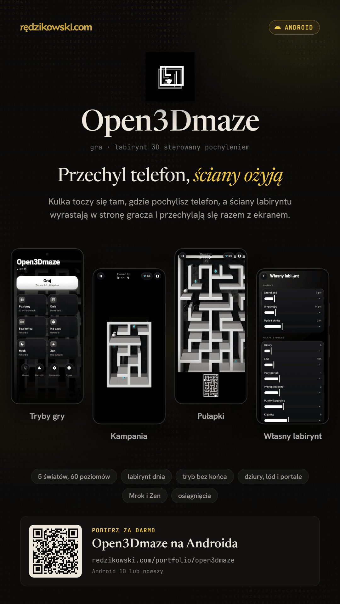

# Open3Dmaze

<!-- posters:start -->
<p align="center">
  
</p>

<p align="center"><a href="https://redzikowski.com/portfolio/open3dmaze">redzikowski.com/portfolio/open3dmaze</a></p>
<!-- posters:end -->

Labirynt na Androida, w którym sterujesz kulką, pochylając telefon. Plansza jest płaska,
ale ściany są bryłami: wyrastają w stronę gracza i przechylają się razem z telefonem,
więc labirynt wygląda jak trójwymiarowy.

## Co jest w środku

- **Kampania** – 5 światów (Obsydian, Otchłań, Szron, Pryzmat, Zaćmienie), 60 poziomów, po 3 gwiazdki.
- **Labirynt dnia**, **Bez końca**, **Wyścig z czasem**, **Mrok**, **Zen** i **Własny labirynt** (rozmiar, pułapki, ziarno).
- Dziury, lód, portale, przyspieszacze, punkty kontrolne i klejnoty.
- Ustawienia efektu 3D, kolory akcentu, wygląd kulki, kalibracja, sterowanie palcem, dźwięki i wibracje.
- Statystyki i osiągnięcia. Czarny interfejs AMOLED.
- Aktualizacje pobierane i instalowane z poziomu aplikacji.

## Wydania

APK powstaje wyłącznie po wypchnięciu tagu wersji:

```bash
git tag v1.0.0
git push origin v1.0.0
```

Wymagania: Android 10 lub nowszy.

---

Pomysł i wykonanie: Adam Rędzikowski · [redzikowski.com](https://redzikowski.com) ·
[☕ Postaw kawę na buycoffee.to](https://buycoffee.to/adamredzikowski)
